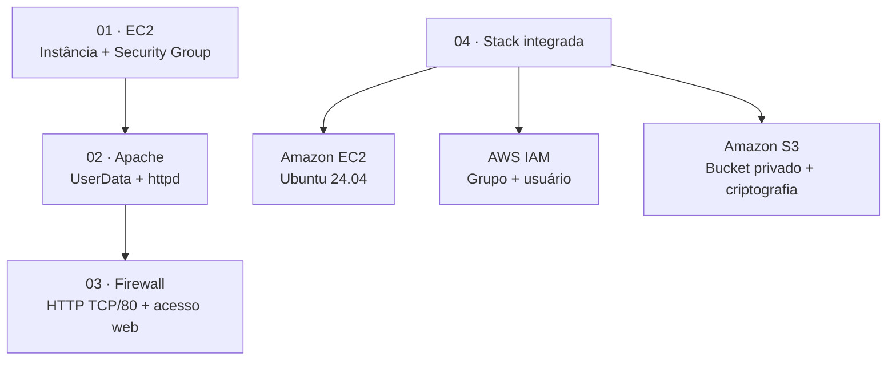

# AWS CloudFormation | Infraestrutura como Código na AWS

> **Projeto prático de Infrastructure as Code (IaC):** quatro templates CloudFormation em YAML para provisionar e configurar recursos de computação, rede, identidade e armazenamento na AWS.

Este projeto transforma exemplos introdutórios em templates parametrizados e reutilizáveis. Além de construir as stacks, o trabalho envolveu revisar configurações originais, identificar dependências de ambiente e aplicar melhorias de segurança e manutenção.

**Tecnologias:** AWS CloudFormation · YAML · Amazon EC2 · Amazon Linux 2023 · Ubuntu 24.04 LTS · Security Groups · AWS Systems Manager Parameter Store · IAM · Amazon S3

## AWS CloudFormation: conceito e funcionamento

O **AWS CloudFormation** é um serviço nativo da AWS para infraestrutura como código (IaC). A infraestrutura desejada é descrita em um template; ao enviar esse template, o CloudFormation provisiona e organiza os recursos em uma unidade gerenciável chamada **stack**.

O template funciona como uma especificação declarativa: descreve quais recursos devem existir e suas configurações, enquanto o CloudFormation determina a ordem de criação com base nas dependências entre eles. A stack também pode ser atualizada ou excluída como um conjunto.

### Benefícios do CloudFormation

- **Automação:** reduz a necessidade de criar recursos manualmente pelo console.
- **Padronização:** permite utilizar a mesma definição de infraestrutura em diferentes ambientes.
- **Reutilização:** parâmetros possibilitam adaptar um template sem reescrever sua estrutura.
- **Rastreabilidade:** templates podem ser versionados no GitHub e revisados como código.
- **Gerenciamento centralizado:** recursos relacionados são acompanhados como uma stack.
- **Controle de mudanças:** change sets permitem visualizar alterações propostas antes de aplicá-las.
- **Tratamento de falhas:** o serviço acompanha eventos da stack e pode executar rollback conforme as configurações e o tipo de operação.

### Formatos dos templates: JSON e YAML

O CloudFormation aceita templates nos formatos **JSON** e **YAML**. Ambos descrevem os mesmos elementos principais, como `Resources`, `Parameters`, `Outputs`, `Mappings` e `Conditions`.

- **JSON:** formato estruturado por objetos e arrays; é explícito e amplamente utilizado por ferramentas.
- **YAML:** formato mais compacto e legível para edição manual, com indentação e menos caracteres estruturais.

Neste repositório foi escolhido **YAML** para facilitar a leitura, a revisão e a manutenção dos exemplos. A escolha do formato não altera os recursos que podem ser definidos pelo CloudFormation.

### CloudFormation x Terraform

CloudFormation e Terraform são ferramentas de infraestrutura como código, mas possuem diferenças importantes.

| Critério | AWS CloudFormation | Terraform |
|---|---|---|
| Desenvolvedor | Amazon Web Services | HashiCorp |
| Foco | Serviços e recursos da AWS | Múltiplos provedores, incluindo AWS, Azure e Google Cloud |
| Linguagem | Templates JSON ou YAML | HCL (HashiCorp Configuration Language) |
| Integração com AWS | Serviço nativo da AWS | Integração por meio do provider AWS |
| Estado da infraestrutura | Gerenciado pelo próprio serviço CloudFormation e pelas stacks | Mantém um arquivo de estado (state), local ou remoto |
| Organização | Stacks e recursos relacionados | Configurações, módulos e workspaces |
| Planejamento de mudanças | Change sets | Comando `terraform plan` |
| Aplicação | Operações de criação e atualização da stack | Comando `terraform apply` |

**Em resumo:** CloudFormation é uma opção natural quando a infraestrutura será gerenciada dentro do ecossistema AWS, com integração nativa aos serviços da plataforma. Terraform é especialmente útil quando se deseja trabalhar com vários provedores de nuvem ou manter uma abordagem consistente de IaC entre diferentes plataformas. A escolha depende do ambiente, da equipe e dos requisitos do projeto.

## Visão geral da arquitetura

A sequência didática evolui da criação de uma instância para a configuração de um servidor web. O quarto template é uma stack independente que reúne EC2, IAM e S3.



## Objetivos técnicos

- Declarar infraestrutura como código usando templates YAML.
- Criar e organizar recursos em stacks do CloudFormation.
- Parametrizar VPC, subnet, tipo de instância e outros valores de implantação.
- Automatizar a configuração de uma instância com `UserData`.
- Controlar o tráfego de rede com Security Groups.
- Integrar recursos EC2, IAM e S3 em um mesmo template.
- Revisar configurações frágeis e documentar decisões técnicas e pré-requisitos.

## Estrutura do repositório

```text
aws-cloudformation-stacks/
├── README.md
├── templates/
│   ├── 01-ec2.yaml
│   ├── 02-apache.yaml
│   ├── 03-firewall.yaml
│   └── 04-ec2-iam-s3.yaml
└── docs/
    └── analise-dos-templates.md
```

## Templates

| Template | Recursos principais | Finalidade |
|---|---|---|
| [01-ec2.yaml](templates/01-ec2.yaml) | EC2 + Security Group | Provisionar uma instância básica |
| [02-apache.yaml](templates/02-apache.yaml) | EC2 + UserData + Apache | Instalar e iniciar um servidor web |
| [03-firewall.yaml](templates/03-firewall.yaml) | EC2 + Apache + Security Group | Permitir acesso HTTP pela porta 80 |
| [04-ec2-iam-s3.yaml](templates/04-ec2-iam-s3.yaml) | EC2 + IAM + S3 | Integrar computação, identidade e armazenamento |

### 01 — Provisionamento de EC2

Cria uma instância Amazon Linux 2023 em uma subnet selecionada. A AMI é obtida por meio de um parâmetro público do AWS Systems Manager Parameter Store, evitando manter um ID de imagem fixo no template.

O Security Group não define regras de entrada nesta etapa. A VPC, a subnet e o tipo de instância são informados por parâmetros.

### 02 — Configuração automática do Apache

Utiliza `UserData` para executar comandos na inicialização da instância: atualizar pacotes, instalar o Apache (`httpd`), habilitar e iniciar o serviço e criar uma página HTML de demonstração.

A instalação do serviço é mantida separada da liberação de tráfego HTTP, que é introduzida no template seguinte.

### 03 — Regras de Firewall e acesso HTTP

Adiciona uma regra de entrada TCP na porta 80 ao Security Group associado à instância. O Apache é instalado automaticamente por `UserData`.

A origem `0.0.0.0/0` permite acesso HTTP público e é utilizada aqui para demonstrar a publicação de um servidor web. Para que o endereço de saída funcione, a subnet escolhida deve ser pública, possuir rota para um Internet Gateway e permitir o tráfego necessário.

### 04 — Integração EC2, IAM e S3

Reúne três áreas de serviços AWS em uma única stack:

- **EC2:** instância Ubuntu 24.04 LTS, com AMI consultada dinamicamente no Parameter Store da Canonical.
- **IAM:** criação de um grupo e de um usuário associado a ele. Nenhuma política administrativa é concedida automaticamente.
- **S3:** bucket com nome gerado pela AWS, bloqueio de acesso público e criptografia padrão.

O acesso SSH é limitado ao CIDR informado no parâmetro `SSHLocation`. A configuração recomendada para laboratório é informar o IP público autorizado com máscara `/32`.

## Decisões técnicas e melhorias aplicadas

Os templates foram revisados para reduzir dependências de valores fixos e evitar configurações inseguras ou pouco reutilizáveis.

| Situação identificada nos exemplos | Ajuste aplicado |
|---|---|
| IDs de AMI fixos | Consulta dinâmica de AMIs por parâmetros públicos do SSM |
| VPC específica da conta | VPC e subnet recebidas por parâmetros |
| Nome de bucket S3 previamente definido | Nome gerado pela AWS |
| Placeholder de Key Pair | Parâmetro tipado para selecionar um Key Pair existente |
| SSH liberado para qualquer origem | CIDR de origem configurável e validado |
| Comandos de instalação incompatíveis com Amazon Linux 2023 | Uso de `dnf` para instalar e iniciar o Apache |
| Configuração de Security Group menos apropriada no exemplo de Firewall | Associação por `SecurityGroupIds` / configuração de interface de rede |

Outras decisões importantes:

- Os templates expõem valores úteis por meio de **Outputs**, como identificador da instância, IP e URL.
- O bucket S3 do quarto template possui `DeletionPolicy: Retain` e `UpdateReplacePolicy: Retain`, evitando sua remoção automática em operações de exclusão ou substituição da stack.
- A criação de um usuário e de um grupo IAM não concede permissões por si só. As políticas devem ser adicionadas conforme a necessidade e o princípio do menor privilégio.

A análise detalhada dos ajustes está em [docs/analise-dos-templates.md](docs/analise-dos-templates.md).

## Como criar uma stack no CloudFormation

1. Acesse o Console de Gerenciamento da AWS e selecione a região.
2. Abra **CloudFormation** e escolha **Create stack**.
3. Selecione a opção para carregar um template existente.
4. Envie o arquivo YAML desejado, localizado em `templates/`.
5. Informe um nome para a stack e preencha os parâmetros.
6. Revise as configurações e as permissões solicitadas.
7. Confirme a criação e acompanhe os eventos até a conclusão.
8. Em caso de falha, consulte os eventos da stack para identificar o recurso e a mensagem de erro.

### Pré-requisitos de implantação

**Templates 01, 02 e 03**
- Uma VPC e uma subnet pertencente a essa VPC.
- Para o template 03, uma subnet pública com rota para Internet Gateway.
- A AMI Amazon Linux 2023 é resolvida regionalmente pelo Parameter Store.

**Template 04**
- Uma VPC e uma subnet pública pertencente a ela.
- Um Key Pair existente na mesma região.
- Um CIDR autorizado para SSH, preferencialmente o IP público atual com máscara `/32`.
- Nomes disponíveis para o usuário e o grupo IAM.
- A AMI Ubuntu é consultada dinamicamente no Parameter Store da Canonical.

## Segurança e custos

- Recursos como EC2, volumes EBS, transferência de dados e outros serviços podem gerar cobranças. Consulte os preços e a elegibilidade dos tipos de instância antes da implantação.
- Não mantenha SSH aberto para `0.0.0.0/0`. Restrinja a origem ao IP ou à rede administrativa necessária.
- O template 03 libera HTTP publicamente para fins didáticos. Em um ambiente real, avalie HTTPS e controles adicionais.
- O bucket S3 é configurado para bloquear acesso público e utilizar criptografia padrão.
- O bucket é retido quando a stack é excluída ou substituída. Sua remoção, se desejada, deve ser tratada separadamente.
- Exclua recursos de laboratório que não estejam mais em uso, respeitando as políticas de retenção.

## Aprendizados

O desenvolvimento deste projeto consolidou conceitos essenciais de IaC e infraestrutura AWS: estrutura de templates, parâmetros, referências entre recursos, outputs, UserData, Security Groups, resolução dinâmica de AMIs, IAM e proteção de buckets S3.

Um dos principais aprendizados foi perceber que um template sintaticamente simples pode depender de condições externas para funcionar: região, VPC, subnet, rotas, Key Pair, permissões e disponibilidade de recursos. Por isso, documentar pré-requisitos e limites de segurança faz parte da solução, não é apenas um complemento.

## Status e validação

**Status atual: templates publicados e documentação estruturada; implantação em conta AWS pendente.**

A publicação no GitHub comprova a disponibilidade dos arquivos, mas não comprova a criação bem-sucedida das stacks. A validação prática no CloudFormation, a inspeção dos eventos e a coleta de evidências serão realizadas quando houver uma conta AWS e os recursos de rede necessários.

Não são apresentados resultados de implantação ou capturas de tela como se os templates já tivessem sido executados.

## Referências oficiais

- [AWS CloudFormation — documentação](https://docs.aws.amazon.com/AWSCloudFormation/latest/UserGuide/Welcome.html)
- [Tipos de parâmetros específicos da AWS](https://docs.aws.amazon.com/AWSCloudFormation/latest/UserGuide/cloudformation-supplied-parameter-types.html)
- [Amazon Linux 2023 — documentação](https://docs.aws.amazon.com/linux/al2023/ug/what-is-amazon-linux.html)
- [Canonical — localizar imagens Ubuntu na AWS](https://ubuntu.com/aws/docs/aws-how-to/instances/find-ubuntu-images/)
- [AWS::EC2::SecurityGroup — referência](https://docs.aws.amazon.com/AWSCloudFormation/latest/TemplateReference/aws-resource-ec2-securitygroup.html)
